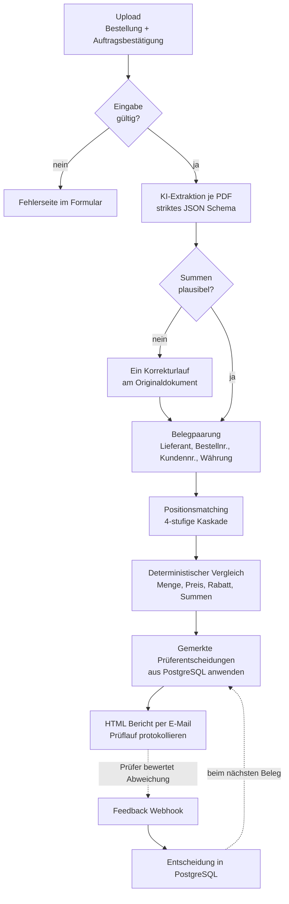
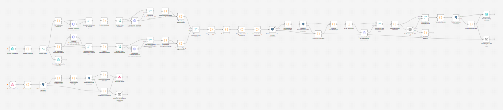
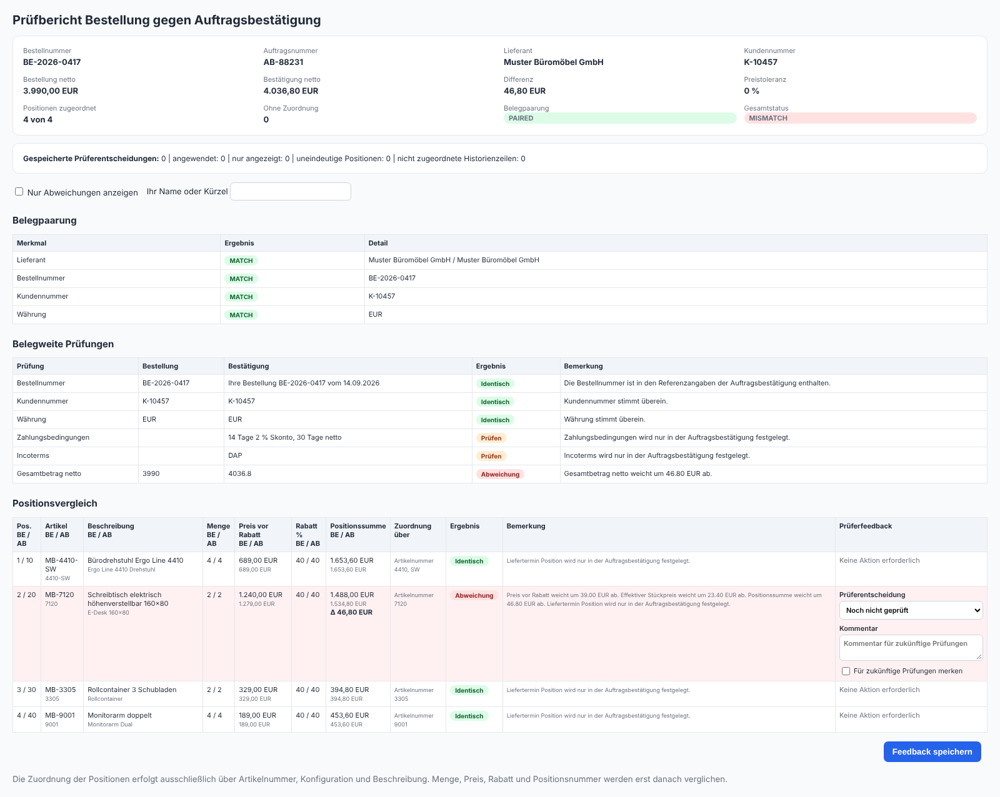
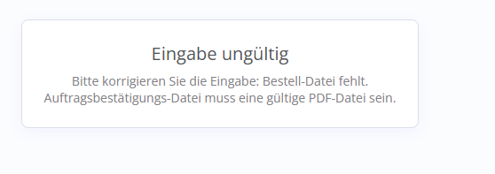

# Belegabgleich Bestellung gegen Auftragsbestätigung

Prüft eine Auftragsbestätigung gegen die eigene Bestellung. Beide PDFs werden per KI strukturiert ausgelesen, danach entscheiden feste Regeln über Belegpaarung, Positionszuordnung und Abweichungen. Der Prüfer bekommt einen interaktiven Bericht per E-Mail und kann Abweichungen direkt bewerten.

## Einordnung

Proof of Concept mit Demo-Daten, vollständig umgesetzt inkl. KI-Extraktion, Datenbank, Fehlerbehandlung, 14 dokumentierten Tests und technischer Doku. Entstanden als Praxisaufgabe in einem Auswahlverfahren, im Vergleich der eingereichten Lösungen auf dem geteilten ersten Platz. Referenz auf Anfrage.

## Stack

n8n Form Trigger und Webhook, OpenAI Responses API (PDF Input, strict JSON Schema, `store: false`), PostgreSQL 16 (Docker), HTML Bericht mit Feedback per `fetch()`, separater Error Workflow mit E-Mail Benachrichtigung.

## Ablauf

## Verarbeitungsschritte

1. PDF Upload validieren, inkl. Dateisignatur `%PDF-`
2. Beide PDFs über ein striktes JSON Schema extrahieren
3. Mengen, Rabatte, Positions- und Belegsummen nachrechnen, bei Widerspruch genau ein Korrekturlauf
4. Belegpaarung über Lieferant, Bestellnummer, Kundennummer und Währung
5. Positionen über eine vierstufige Kaskade zuordnen
6. Menge, Preise, Rabatt, Positionssummen, Vertragsfelder und Belegsummen regelbasiert vergleichen
7. Gemerkte Prüferentscheidungen aus PostgreSQL anwenden
8. Interaktiven HTML Bericht versenden und Prüflauf protokollieren

## Highlights

- KI liest, Regeln entscheiden: Die KI strukturiert nur die PDFs. Ob eine Abweichung vorliegt, entscheidet deterministischer Code. Jedes Ergebnis ist nachvollziehbar.
- Zuordnung vor Vergleich: Die eigentliche Arbeit liegt in der Zuordnung der Positionen. Lieferanten schreiben Artikelnummern anders und sortieren anders. Eine rein positionsbasierte Prüfung meldet dort Abweichungen, obwohl fachlich keine vorliegen.
- Matching ohne feste Schwelle: Gewichtete Bridge-Tokens, gegenseitig bester Kandidat und Gleichstandserkennung statt einer willkürlichen Mindest-Coverage.
- Falsches Belegpaar wird erkannt: Bei Konflikt in Lieferant, Bestellnummer oder Kundennummer wird `WRONG_DOCUMENT_PAIR` gesetzt und gar nicht erst Position für Position verglichen.
- Prüferfeedback mit Gedächtnis: Eine gemerkte und akzeptierte Preisabweichung stuft beim nächsten Beleg `BLOCKING` auf `REVIEW` herunter. Aber nur bei exakt gleicher Differenzsignatur und reinen Preisfeldern. Das Feedback geht nicht in den Prompt, die KI lernt nichts davon.
- Robust bei Ausfall: Fällt PostgreSQL aus, läuft die Prüfung ohne Historie weiter und der Bericht weist darauf hin.
- 14 dokumentierte Tests: Referenzlauf, Preisabweichung mit 0 % und 5 % Toleranz, Feedback speichern und wiederverwenden, falsches Belegpaar, ungültige Dateien, OpenAI-, SMTP- und Datenbankfehler, Teilbestätigung.

## Statuslogik

| Ebene | Werte |
|---|---|
| Belegpaarung | `PAIRED`, `UNVERIFIED`, `WRONG_DOCUMENT_PAIR` |
| Einzelprüfung | `MATCH` < `INFO` < `REVIEW` < `BLOCKING` |
| Gesamtstatus | `MATCH`, `MANUAL_REVIEW`, `MISMATCH` |

## Code Snippets

| Datei | Zweck |
|---|---|
| `architecture.mermaid` | Ablaufdiagramm |
| `code-snippets/validate-pdf-upload.js` | PDF Signatur, E-Mail, Toleranz und Feedback-URL aus Request Headern |
| `code-snippets/extraction-schema.md` | JSON Schema der KI-Extraktion und Plausibilisierung |
| `code-snippets/check-document-pairing.js` | Belegpaarung über Lieferant, Bestellreferenz, Kundennummer, Währung |
| `code-snippets/match-positions.js` | Vierstufige Positionszuordnung mit Bridge-Tokens und gegenseitig bestem Kandidaten |
| `code-snippets/compare-positions.js` | Deterministischer Vergleich, Preistoleranz, Summenabstimmung, Gesamtstatus |

## Samples

| Datei | Inhalt |
|---|---|
| `samples/order-extraction.example.json` | Extrahierte Bestellung |
| `samples/pairing-result.example.json` | Ergebnis der Belegpaarung |
| `samples/matching-result.example.json` | Positionszuordnung mit Signal und Coverage |
| `samples/comparison-result.example.json` | Belegweite Prüfungen und eine Position mit Preisabweichung |
| `samples/feedback-row.example.json` | Gespeicherte Prüferentscheidung mit Differenzsignatur |

## Screenshots

### n8n Canvas (54 Nodes)

### Interaktiver Prüfbericht

### Ungültige Eingabe

## Hinweis

Lieferant, Belegnummern und Positionen in Samples und Prüfbericht sind erfunden. Der Bericht wurde mit dem Originalcode des Workflows und diesen Demo-Daten erzeugt. Es werden keine vollständigen n8n Workflow Exporte, Credentials oder Originalbelege aus der Aufgabe veröffentlicht.
