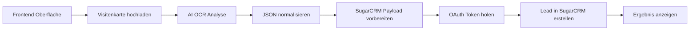
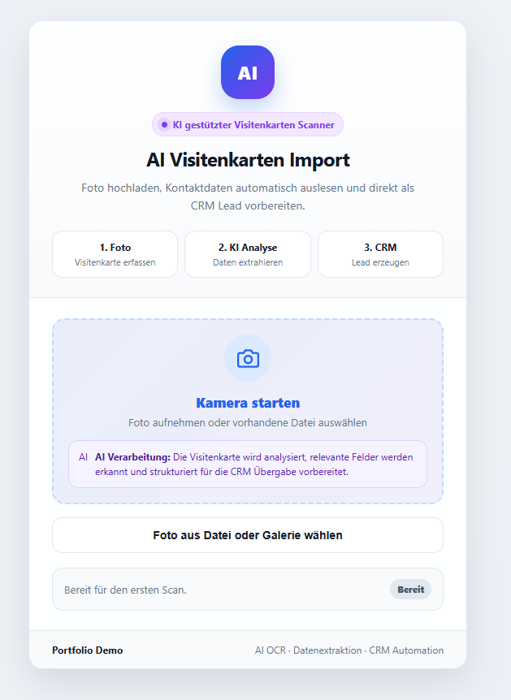
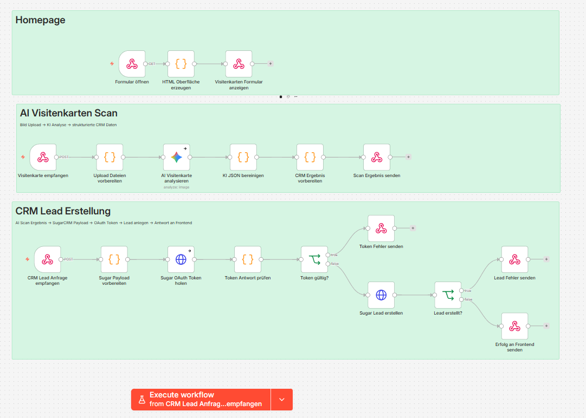
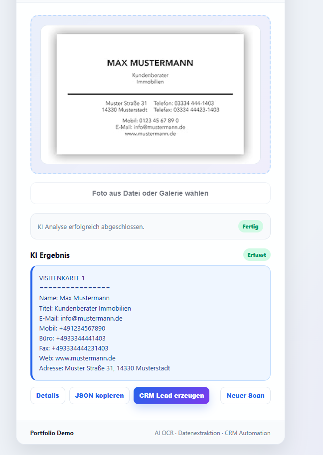

# AI Visitenkarten Import

Visitenkarte fotografieren, Kontaktdaten per AI/OCR extrahieren und als SugarCRM Lead vorbereiten.

## Stack

n8n, Gemini Vision, SugarCRM REST API, OAuth 2.0, Webhook Frontend.

## Ablauf



## Screenshots

### Demo Oberfläche


### n8n Canvas


### Scan Ergebnis


## Code Snippets

| Datei | Zweck |
|---|---|
| `code-snippets/normalize-card.js` | Bereinigt AI Output, normalisiert Telefonnummern auf E.164, Email, URL, Firmenrechtsformen, PLZ Extraktion |
| `code-snippets/map-ai-card-to-sugar.js` | Mapping auf SugarCRM Lead Payload mit Email-Array, geteilten Phone-Feldern und Audit Description |

## Inhalt

```text
screenshots/    Demo Bilder
samples/        Beispiel Input und Output
code-snippets/  Ausgewählte bereinigte Logik
```

Die vollständigen n8n Workflow Exporte sind bewusst nicht enthalten.
