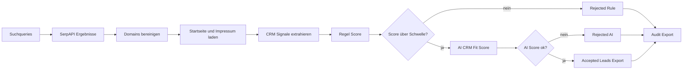

# AI Lead Research Agent

Automatisierte B2B Lead Recherche mit Domain Bereinigung, Website Analyse, SugarCRM Signalprüfung, AI Scoring und Excel Audit Export.

## Stack

n8n, SerpAPI, Gemini, HTML Parsing, SugarCRM Fit Scoring, XLSX Audit Export.

## Ablauf

## Verarbeitungsschritte

1. Suchqueries definieren
2. SerpAPI Ergebnisse abrufen
3. Domains bereinigen und bekannte Domains überspringen
4. Startseite und Impressum analysieren
5. CRM Signale, E-Mail, Telefon und Firmendaten extrahieren
6. Regel Score berechnen
7. AI CRM Fit Score erzeugen
8. Accepted Leads und Audit Export schreiben

## Code Snippets

| Datei | Zweck |
|---|---|
| `code-snippets/normalize-domain.js` | URL-Normalisierung, Subdomain-Strip, Tracking-Param Filter, Blacklist gegen Job/Portal/Branchenbuch Domains |
| `code-snippets/score-crm-signals.js` | Regel-Score aus positiven Signalen (Vertrieb, Standorte) minus Anti-Patterns (Agentur, CRM Berater), Schwellen-Entscheidung |
| `code-snippets/ai-output-schema.md` | Erwartetes AI Output Schema |
| `code-snippets/scoring-rules.md` | Beschreibung der Scoring-Regeln im Workflow |

## Screenshots

| Datei | Inhalt |
|---|---|
| `01-overview.png` | Ablaufübersicht |
| `02-canvas.png` | Canvas Übersicht |
| `03-result-accepted.png` | Accepted Leads Export |
| `04-audit.png` | Audit und Run Summary |

## Hinweis

Es werden keine vollständigen n8n Workflow Exporte, Credentials, echten Kundendaten oder internen Pfade veröffentlicht.
