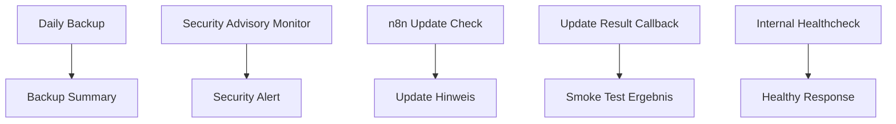
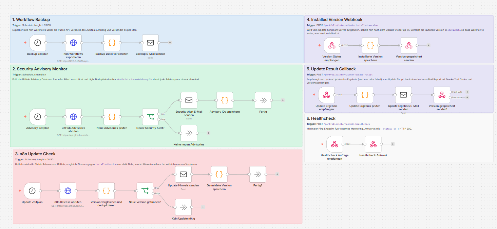
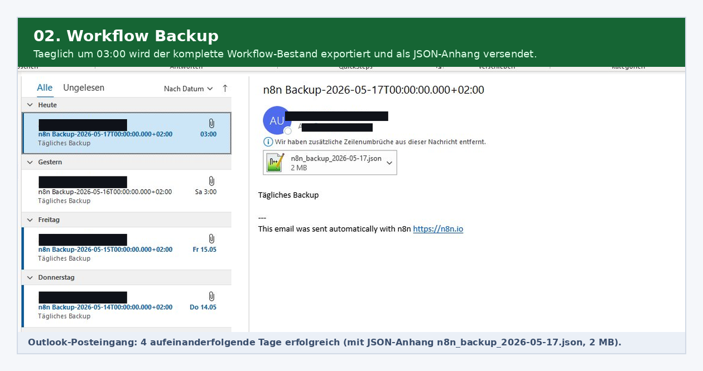
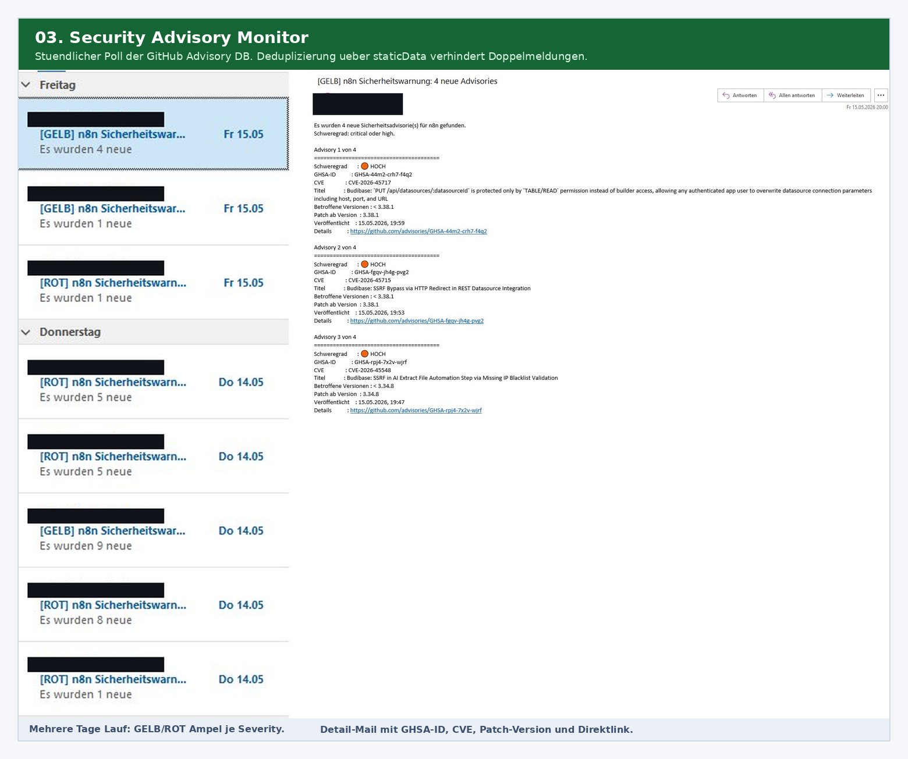
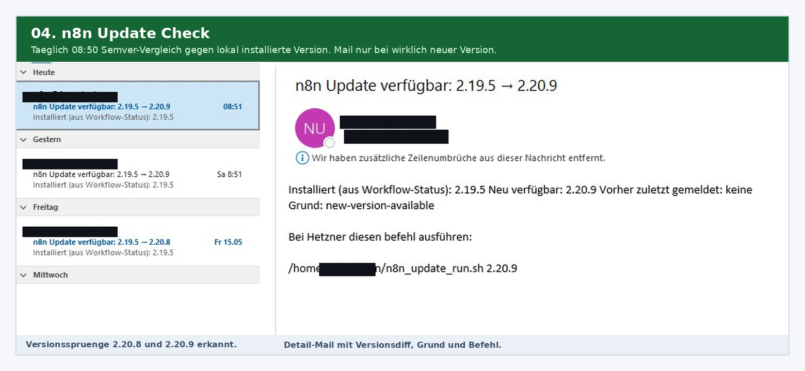
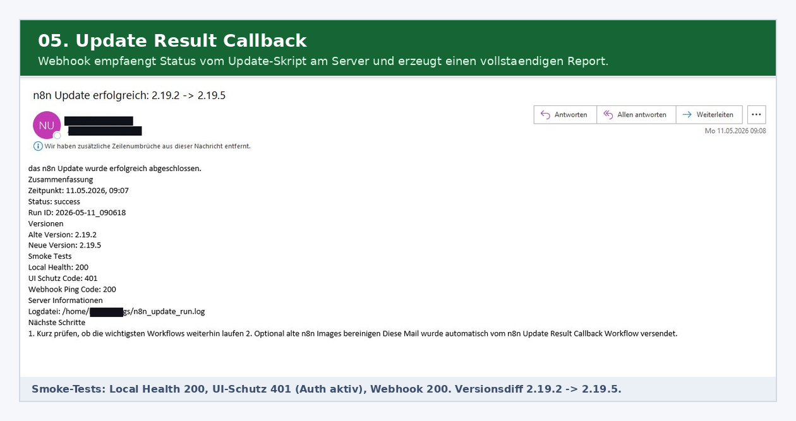

# n8n Production Ops

Betriebsnahe n8n Automationen für Backup, Security Advisory Monitoring, Update Check und Healthcheck.

## Stack

n8n, GitHub Security Advisories API, Docker Update Workflow, Slack/E-Mail Benachrichtigung, interner Healthcheck Endpoint.

## Ablauf



## Screenshots

### Ops Canvas


### Backup Ergebnis


### Security Advisory


### Update Check


### Update Callback


## Code Snippets

| Datei | Zweck |
|---|---|
| `code-snippets/build-health-response.js` | Aggregiert mehrere Subsystem Checks zu einer health+json kompatiblen Response, leitet HTTP Status ab |
| `code-snippets/dedupe-advisories.js` | Filtert GitHub Advisories nach Severity, Alter und Relevanz, pflegt rollierende Known-IDs Liste |
| `code-snippets/compare-versions.js` | SemVer-Vergleich, Update-Klassifizierung (patch/minor/major), Smoke Test Empfehlung, Auto-Update Entscheidung |

## Inhalt

```text
screenshots/    Demo Bilder
samples/        Beispiel Input und Output
code-snippets/  Ausgewählte bereinigte Logik
```

Die vollständigen n8n Workflow Exporte sind bewusst nicht enthalten.
