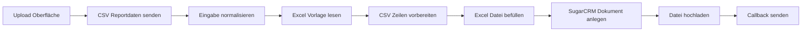
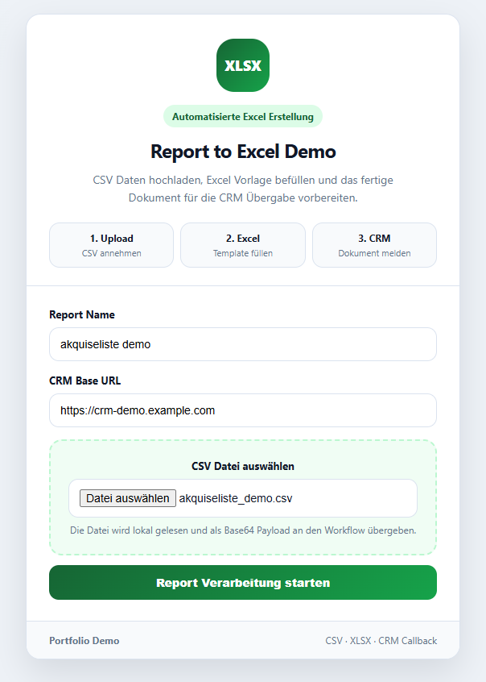
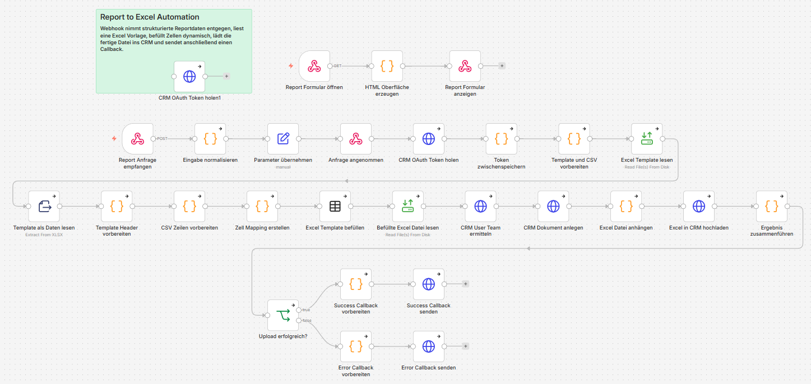
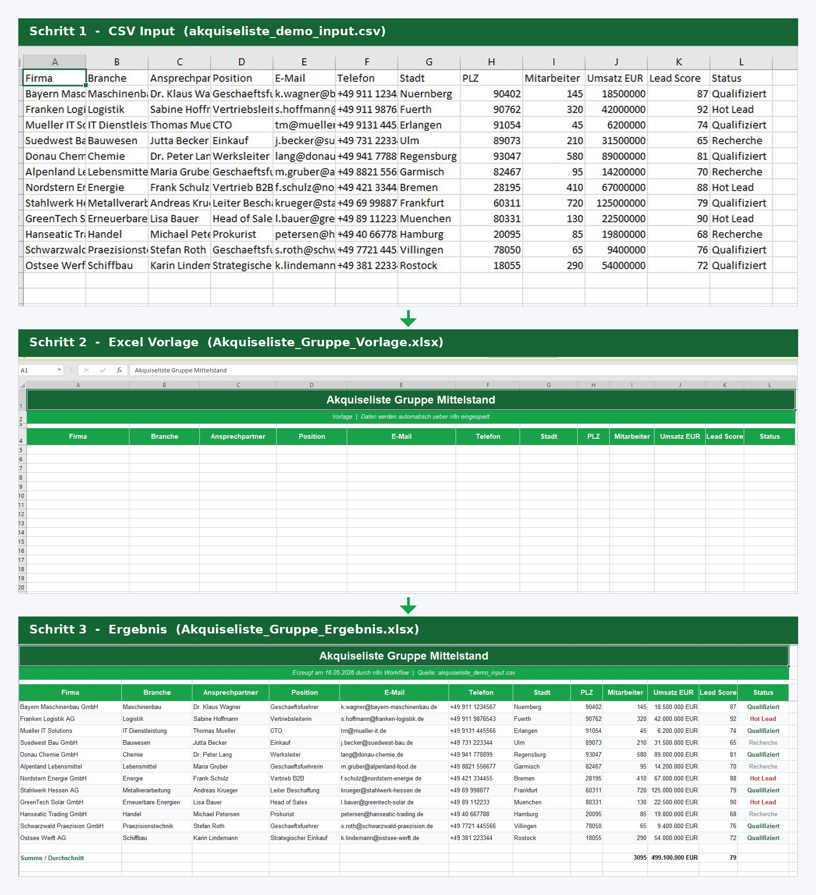

# Report to Excel Automation

CSV Reportdaten hochladen, Excel Vorlage befüllen und Ergebnis als SugarCRM Dokument vorbereiten.

## Stack

n8n, XLSX Node, SugarCRM REST API, OAuth 2.0, asynchrone Webhook Callbacks.

## Ablauf



## Screenshots

### Upload Oberfläche


### n8n Canvas


### CSV, Vorlage und Ergebnis


## Code Snippets

| Datei | Zweck |
|---|---|
| `code-snippets/normalize-report-request.js` | Validiert Pflichtfelder, Base64 CSV Format, Dateinamen Pattern und Callback URL HTTPS |
| `code-snippets/build-template-cell-data.js` | Header Mapping (CSV zu Excel Vorlage), Typ-Casting (Number, Currency, Date), Aggregations-Zeile |
| `code-snippets/build-callback-payload.js` | Success, Error und Partial Callbacks mit Error-Code Klassifikation und Retry-Logik |

## Inhalt

```text
screenshots/    Demo Bilder
samples/        Beispiel Input und Output
code-snippets/  Ausgewählte bereinigte Logik
```

Die vollständigen n8n Workflow Exporte sind bewusst nicht enthalten.
