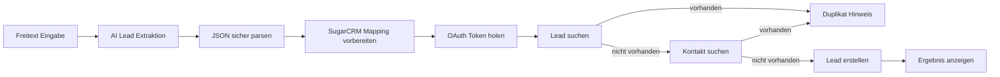
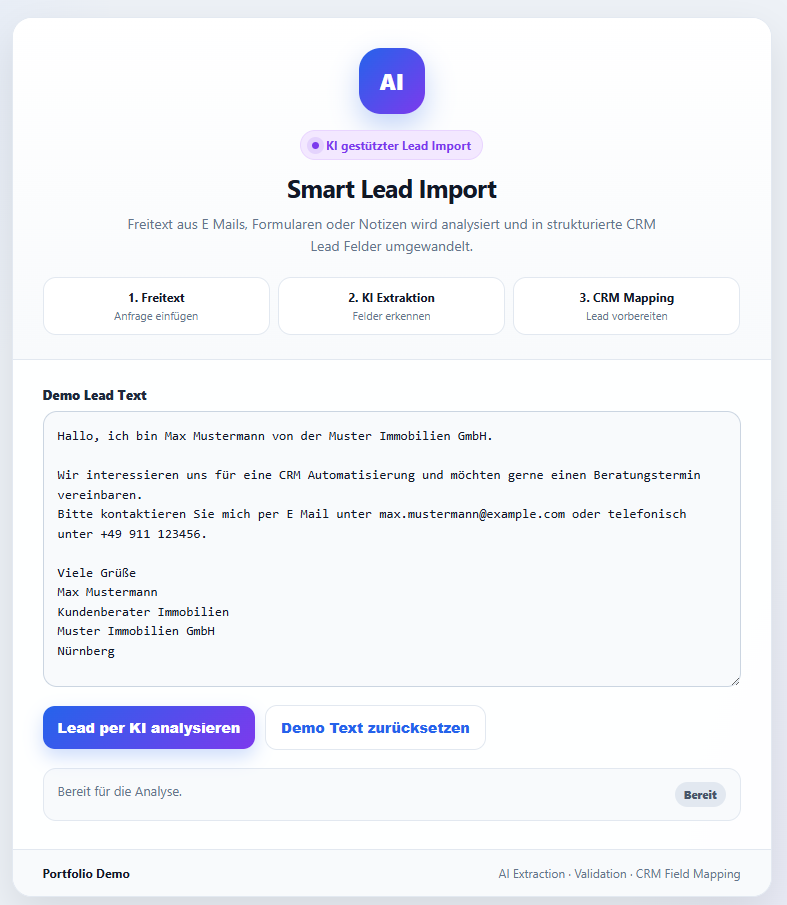
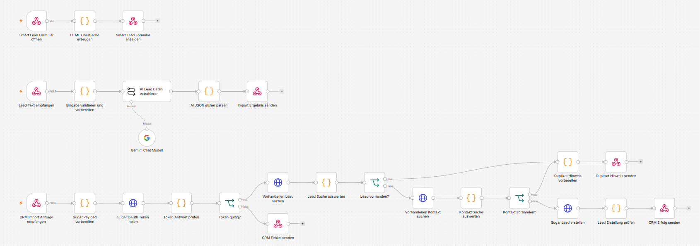
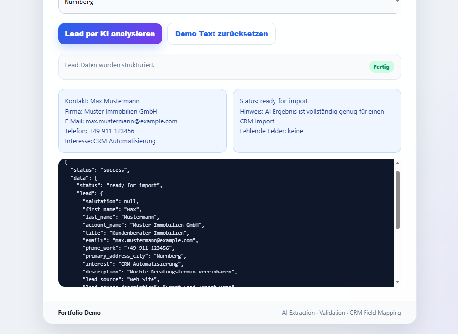

# Smart Lead Import

Freitext Lead per AI strukturieren, SugarCRM Mapping vorbereiten und vor dem Import auf vorhandene Leads oder Kontakte prüfen.

## Stack

n8n, Gemini, SugarCRM REST API, OAuth 2.0, Duplikatprüfung gegen Leads und Contacts.

## Ablauf



## Pipeline Stufen

```text
AI Extraktion  ->  AI Validierung  ->  SugarCRM Mapping  ->  Duplikatpruefung  ->  CRM Import
```

| Stufe | Datei | Felder |
|---|---|---|
| AI Extraktion | `samples/ai-extraction.example.json` | neutral: `firstName`, `lastName`, `company`, `email` |
| AI Validierung | `code-snippets/validate-ai-extraction.js` | prueft die neutralen AI Felder, liefert Confidence Score |
| SugarCRM Mapping | `code-snippets/map-ai-lead-to-sugar.js` | uebersetzt auf SugarCRM Felder, splittet Phone in mobile/work |
| Import Output | `samples/output.example.json` | SugarCRM: `first_name`, `last_name`, `account_name`, `email1` |
| Duplikatpruefung | `samples/duplicate-alert.example.json` | Treffer gegen Lead oder Contact |

## Screenshots

### Demo Oberfläche


### n8n Canvas


### Extraktion Ergebnis


## Inhalt

```text
screenshots/    Demo Bilder
samples/        Beispiel Input und Output
code-snippets/  Ausgewählte bereinigte Logik
```

Die vollständigen n8n Workflow Exporte sind bewusst nicht enthalten.
