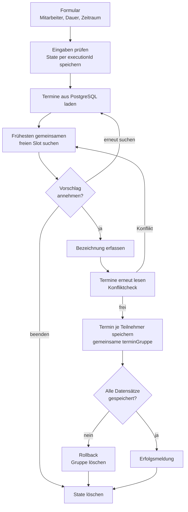
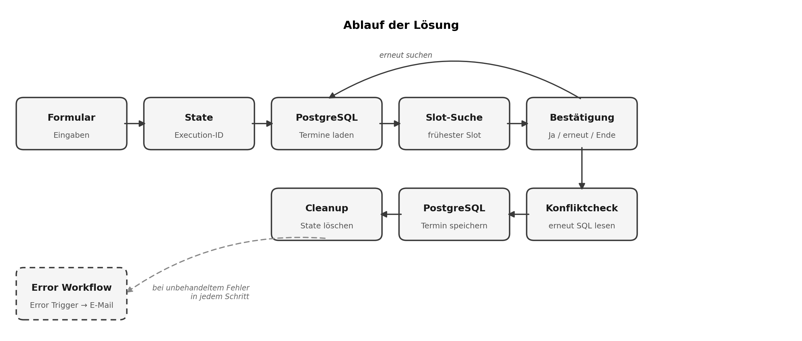
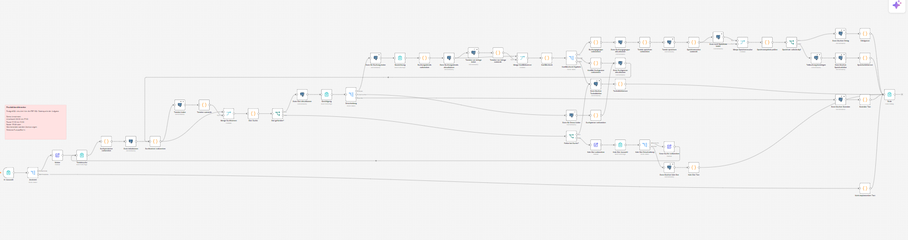
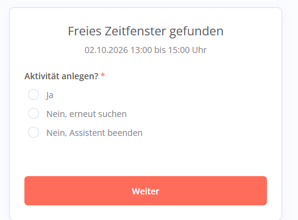
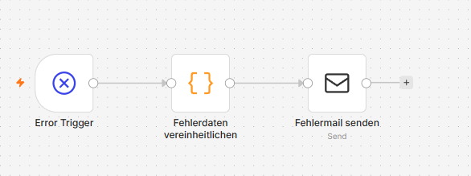

# Terminfinder

Findet über ein n8n Formular das nächste gemeinsame freie Zeitfenster für mehrere Mitarbeiter, prüft den Slot direkt vor dem Speichern erneut und legt den Termin für alle Teilnehmer in PostgreSQL an.

## Hintergrund

Praxisaufgabe aus einem Bewerbungsverfahren für eine Automation Stelle. Im Vergleich der eingereichten Lösungen geteilter erster Platz. Referenz auf Anfrage.

## Stack

n8n Form Trigger und mehrstufige Formulare, PostgreSQL 16 (Docker), parametrierte SQL Abfragen, separater Error Workflow mit E-Mail Benachrichtigung.

## Ablauf

## Verarbeitungsschritte

1. Mitarbeiter, Dauer und Suchzeitraum im Formular erfassen
2. Eingaben validieren und den State der Formular Execution in PostgreSQL ablegen
3. Termine für den Suchzeitraum über parametrierte SQL Abfragen laden
4. Belegung aller Teilnehmer zusammenführen und den frühesten freien Slot suchen
5. Vorschlag bestätigen, erneut suchen oder abbrechen
6. Direkt vor dem Speichern die aktuellen Termine erneut lesen und den Slot prüfen
7. Je Teilnehmer einen Datensatz mit gemeinsamer `terminGruppe` speichern
8. Bei Teilfehlern alle Datensätze der Gruppe zurückrollen, danach State aufräumen

## Terminregeln

| Regel | Wert |
|---|---|
| Zeitzone | Europe/Berlin, inkl. Sommer und Winterzeit |
| Arbeitstage | Montag bis Freitag |
| Arbeitszeit | 08:00 bis 17:00 Uhr |
| Mittagspause | 12:00 bis 13:00 Uhr |
| Raster | 15 Minuten |
| Suchzeitraum | max. 400 Kalendertage |

## Highlights

- Kein Doppelbuchen: Zwischen Bestätigung und Speichern kann ein anderer Termin entstehen. Der Workflow liest die Daten deshalb vor dem INSERT erneut und schlägt bei Konflikt automatisch eine Alternative vor.
- Keine halben Gruppentermine: Alle Datensätze einer Buchung teilen eine `terminGruppe`. Fehlt ein Datensatz, wird die ganze Gruppe gelöscht.
- SQL Injection getestet: Eine Bezeichnung wie `Meeting O'Brien; DROP TABLE termine;--` landet als reiner Text in der Spalte.
- Zeitzonen sauber: PostgreSQL speichert `timestamptz`, gelesen wird als UTC ISO, gerechnet und angezeigt in Europe/Berlin.
- Zentrale Fehlermeldung: Der Error Workflow vereinheitlicht die beiden Fehlerstrukturen von n8n (Fehler in der Execution oder im Trigger Node).
- 10 dokumentierte Tests: Standardsuche, mehrfaches Suchen, kein Treffer, Konflikt vor dem Speichern, Rollback, SQL Parametrisierung und Fallbacks.

## Code Snippets

| Datei | Zweck |
|---|---|
| `architecture.mermaid` | Ablaufdiagramm |
| `code-snippets/find-free-slot.js` | Belegung zusammenführen, Arbeitsfenster in Europe/Berlin berechnen, frühesten freien Slot im 15 Minuten Raster finden |
| `code-snippets/revalidate-slot.js` | Gespeicherten Slot vor dem INSERT gegen Terminregeln und aktuelle Termine prüfen |
| `code-snippets/booking-queries.sql` | Parametrierte Abfragen für Laden, Speichern und Rollback |
| `code-snippets/normalize-error-data.js` | Error Trigger Daten aus Execution und Trigger Node vereinheitlichen |

## Samples

| Datei | Inhalt |
|---|---|
| `samples/search-input.example.json` | Formulareingabe der Terminsuche |
| `samples/slot-result.example.json` | Ergebnis der Slot-Suche |
| `samples/booking-result.example.json` | Gespeicherte Datensätze einer Gruppenbuchung |

## Screenshots

### Ablaufübersicht

### n8n Canvas (58 Nodes)

### Gefundenes Zeitfenster

### Error Workflow

## Hinweis

Alle Namen und Termine in den Beispielen sind erfunden. Es werden keine vollständigen n8n Workflow Exporte, Credentials oder Originaldaten aus der Aufgabe veröffentlicht.
